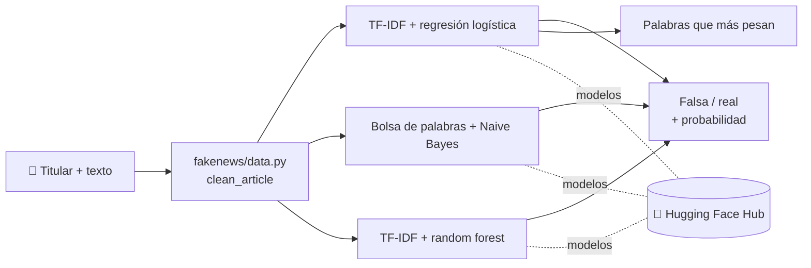
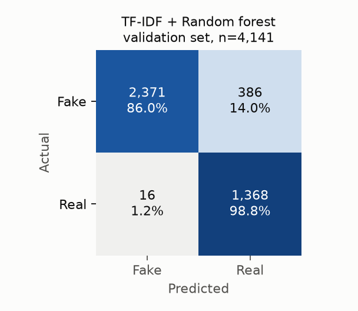

<div align="center">

# 📰 Fake News Classifier

**Tres pipelines de NLP con scikit-learn que clasifican noticias en inglés como falsas o reales, evaluados sobre 4.141 artículos que no vieron al entrenar.**


[Qué hace](#-qué-hace) · [Puesta en marcha](#-puesta-en-marcha-en-3-pasos) · [Requisitos](#-requisitos-del-equipo) · [Modelos](#-modelos) · [Entrenamiento](#-entrenamiento) · [Problemas comunes](#-problemas-comunes)

</div>

---

## ✨ Qué hace

Pegas el titular y el texto de una noticia (o eliges uno de los ejemplos) y tres modelos dicen si es **falsa o real**: **TF-IDF + regresión logística**, **bolsa de palabras + Naive Bayes** y **TF-IDF + random forest**.

| Pestaña | Qué obtienes |
|---|---|
| 🧾 **Verdict** | La probabilidad de falsa y de real según cada modelo y las palabras del artículo que más empujan a la regresión logística hacia un lado u otro. |
| 📏 **How reliable are they?** | La exactitud de cada modelo sobre el conjunto de validación, con y sin las fugas de datos del planteamiento original, y qué aprenden de verdad. |



> ⚠️ **Qué aprenden y qué no.** En el dataset ISOT, la etiqueta depende de la **fuente**: las noticias reales son teletipos de Reuters y las falsas vienen de webs señaladas por PolitiFact y Wikipedia (2015-2018). Los modelos aprenden a distinguir el **estilo de agencia** (*said*, *spokesman*, el día de la semana) del estilo de esas webs (*video*, *watch*, *just*). **No comprueban hechos.** La app incluye un ejemplo inventado para comprobarlo: una noticia absurda escrita como un teletipo sale como real con un 99-100 % de probabilidad.

- Los modelos **se descargan solos** de Hugging Face la primera vez y quedan guardados en un volumen de Docker.
- Todo corre en local, en CPU, sin claves ni `.env`.

---

## 🏁 Puesta en marcha en 3 pasos

> Solo necesitas **[Docker Desktop](https://www.docker.com/products/docker-desktop/)** abierto y **[Git](https://git-scm.com/downloads)**. No hace falta instalar Python ni descargar datos a mano.

### 1️⃣ Clona el repositorio

```bash
git clone https://github.com/JTiiz/natural-processing-models.git
cd natural-processing-models
```

### 2️⃣ Construye y arranca

```bash
docker compose up --build -d
```

⏱️ El primer build tarda un par de minutos. Los siguientes arranques tardan segundos.

### 3️⃣ Abre la app

👉 **http://localhost:8503**

> ℹ️ La **primera** carga tarda unos segundos más porque descarga los tres modelos (≈ 26 MB). Después quedan en caché y cada clasificación es instantánea.

---

## 💻 Requisitos del equipo

| Recurso | Mínimo | Recomendado | Por qué |
|---|---|---|---|
| 🧠 **RAM** | 2 GB | 4 GB | Con los tres modelos cargados, el contenedor usa unos 420 MB. |
| 💾 **Disco libre** | 2 GB | 3 GB | Imagen Docker ≈ 1 GB + modelos ≈ 26 MB + caché de build. |
| ⚙️ **CPU** | 1 núcleo | 2 núcleos | Clasificar un artículo con los tres modelos tarda unas décimas de segundo. |
| 🎮 **GPU** | No necesaria | — | scikit-learn no usa GPU, ni siquiera para entrenar (1 minuto en un portátil). |
| 🌐 **Internet** | Necesario | — | Para el primer build y la primera descarga de los modelos. |

| Software | Notas |
|---|---|
| 🐳 Docker Desktop 4.x+ | En Windows, con el backend **WSL 2**. Incluye `docker compose`. |
| 🔧 Git | Para clonar el repositorio. |

---

## 🧰 Comandos útiles

| Acción | Comando |
|---|---|
| ▶️ Arrancar (sin reconstruir) | `docker compose up -d` |
| 📜 Ver logs en directo | `docker logs -f fake-news-classifier` |
| ⏹️ Parar | `docker compose down` |
| 🔁 Reconstruir tras cambiar código | `docker compose up --build -d` |
| 🗑️ Borrar también los modelos descargados | `docker compose down -v` |

---

## 🤖 Modelos

Los tres se entrenan con los mismos 27.748 artículos y se evalúan sobre los **mismos 4.141 artículos** de `validation_data.csv` que no son copia de ningún artículo de entrenamiento. Se declaran en [`models/models.yaml`](models/models.yaml).

| Modelo | Hugging Face | Exactitud en validación | ROC AUC | Sección no vista (US_News) | Test interno |
|---|---|---|---|---|---|
| **TF-IDF + regresión logística** | [jramduran/fake-news-tfidf-logreg](https://huggingface.co/jramduran/fake-news-tfidf-logreg) | **95,6 %** | **0,998** | **90,8 %** | 98,8 % |
| **Bolsa de palabras + Naive Bayes** | [jramduran/fake-news-bow-naive-bayes](https://huggingface.co/jramduran/fake-news-bow-naive-bayes) | 91,8 % | 0,957 | 78,2 % | 95,9 % |
| **TF-IDF + random forest** | [jramduran/fake-news-tfidf-random-forest](https://huggingface.co/jramduran/fake-news-tfidf-random-forest) | 90,3 % | 0,993 | 80,7 % | 97,4 % |

<p align="center">
  
  
  
</p>

Los tres fallan sobre todo en un sentido: **dejan pasar noticias falsas como reales** (entre 176 y 386 de 2.757) y casi nunca marcan como falsa una real (entre 5 y 22 de 1.384). La sección que no vieron al entrenar pesa más de lo que le toca: US_News es el 28 % de las falsas de validación, pero aporta el 41 % de las que se le escapan a la regresión logística (72 de 176).

**Cómo se resuelve cada modelo:**
1. Si existe `models/<folder>/` (por ejemplo, un modelo que acabas de entrenar), se usa esa copia local.
2. Si no, se descarga del `hub_id` de Hugging Face.

---

## 🧪 Entrenamiento

El código está en [`training/`](training/) y es reproducible de principio a fin.

| | |
|---|---|
| **Datos** | [ISOT Fake News Dataset](https://onlineacademiccommunity.uvic.ca/isot/2022/11/27/fake-news-detection-datasets/) (Universidad de Victoria), en la versión del proyecto de Ironhack: `data.csv` para entrenar y [`data/validation_data.csv`](data/validation_data.csv) como validación externa. `data.csv` no se redistribuye: los mismos artículos se leen de una [copia en Hugging Face](https://huggingface.co/datasets/haoxianc/gilchr_fake-and-real-news-dataset) (MIT) con revisión fija. Coincide al 100 % con `data.csv`, aunque con la etiqueta invertida, que se corrige al cargar. |
| **Etiquetas de validación** | `validation_data.csv` venía sin etiquetar (`label = 2`). Como en ISOT la etiqueta depende de la sección, se recuperan de la columna `subject`: `worldnews` es real y el resto falsas. |
| **Limpieza** | Minúsculas y solo letras, como en los notebooks. Además se quitan los marcadores que delatan la fuente: la firma de Reuters, los créditos de imagen, los enlaces y las menciones @. |
| **División** | Se eliminan los duplicados **antes** de separar un 20 % de test interno. La validación es externa y no incluye copias de artículos de entrenamiento. |
| **Hardware** | CPU · **1 minuto** los seis entrenamientos (3 modelos × 2 configuraciones) |

**Tres fugas de datos en el planteamiento original.** Los notebooks llegaban a un 99,9 % de exactitud. Al revisarlos aparecieron tres problemas:

1. **Una sola palabra separaba las clases.** El 99,2 % de las noticias reales empieza con *"WASHINGTON (Reuters) -"* y ninguna falsa lo hace. A su vez, casi la mitad de las falsas de entrenamiento (las de la sección *News*) acaba con *"Featured image via…"*.
2. **Había 3.418 artículos repetidos** en los datos de entrenamiento, que con una división al azar caían a la vez en train y en test.
3. **815 de los 4.956 artículos de validación eran copias** de artículos de entrenamiento, publicados otra vez en otra sección. Por ejemplo, todos los de *Middle-east*.

Los modelos se entrenan de las dos formas y se comparan sobre los mismos 4.141 artículos de validación:

<p align="center">
  
</p>

| Modelo | Original (notebooks) | Limpia (la de la app) |
|---|---|---|
| TF-IDF + regresión logística | 96,0 % | 95,6 % |
| Bolsa de palabras + Naive Bayes | 91,2 % | 91,8 % |
| TF-IDF + random forest | 98,9 % | 90,3 % |

**Lectura de resultados:**
- 🔵 La **regresión logística** es la más fiable: apenas cambia al quitar las fugas, y es la que mejor resiste la sección que no vio al entrenar (US_News).
- 🟠 El **random forest** parecía el mejor modelo, pero su ventaja venía casi entera de la palabra *reuters*. Sin ella, cae del 98,9 % al 90,3 %.
- 🟡 **Naive Bayes** mejora un poco con la limpieza y los bigramas, pero sigue siendo el más débil con secciones nuevas (78 %).
- ⚪ Lo que queda es **estilo**. Las palabras que más pesan en la regresión logística son estas:

<p align="center">
  
</p>

**Reproducirlo** (requiere [uv](https://github.com/astral-sh/uv)):

```bash
uv sync --group train
uv run --group train python training/train.py      # descarga el dataset (116 MB) y entrena
uv run --group train python training/report.py     # gráficas y tabla comparativa
uv run python training/examples.py                 # ejemplos de la app (data/examples.json)
```

`train.py` deja los modelos en `models/fake-news-<modelo>/`, así que la app los usa automáticamente en lugar de los de Hugging Face. Las métricas y las probabilidades de validación se guardan en `training/reports/`.

> 📓 Los notebooks de [`notebooks/`](notebooks/) son el trabajo original: análisis exploratorio, un notebook por modelo y la comparación final. Algunas cosas que conviene saber al leerlos:
> - El EDA etiqueta las clases al revés: 0 es falsa y 1 es real.
> - Los gráficos de palabras de Naive Bayes muestran las palabras más frecuentes de cada clase, no las más discriminantes.
> - La validación solo contaba cuántos artículos salían falsos, porque no tenía etiquetas.

---

## ⚙️ Configuración

| Variable | Por defecto | Descripción |
|---|---|---|
| `MODELS_ROOT` | `/app/models` | Carpeta donde se buscan modelos locales antes de ir a Hugging Face. |

---

## 🩺 Problemas comunes

<details>
<summary><b>❌ <code>Cannot connect to the Docker daemon</code></b></summary>

Docker Desktop no está abierto. Ábrelo, espera a que indique *Engine running* y repite el comando.
</details>

<details>
<summary><b>❌ <code>port is already allocated</code> (puerto 8503 ocupado)</b></summary>

Otro proceso usa el puerto 8503. Cambia el mapeo en `docker-compose.yml`, por ejemplo a `"8504:8501"`, y entra por `http://localhost:8504`.
</details>

<details>
<summary><b>❌ La primera carga se queda en "Loading the three models..."</b></summary>

La app está descargando los modelos de Hugging Face. Comprueba tu conexión y mira el progreso con `docker logs -f fake-news-classifier`. Si falla a mitad, recarga la página y la descarga se reanudará.
</details>

<details>
<summary><b>❌ Una noticia en español sale siempre como falsa o real</b></summary>

Los modelos solo conocen vocabulario en inglés de 2015-2018. Con otro idioma casi ninguna palabra coincide y el resultado no significa nada.
</details>

---

## 🛠️ Desarrollo local (sin Docker)

Requiere Python 3.12 y [uv](https://github.com/astral-sh/uv).

```bash
uv sync
uv run streamlit run app.py      # http://localhost:8501
```

---

## 📂 Estructura del proyecto

```text
.
├── app.py                    # App Streamlit: veredicto de los tres modelos y su fiabilidad
├── fakenews/
│   └── data.py               # Carga del dataset y limpieza del texto (entrenamiento y app)
├── data/
│   ├── validation_data.csv   # Validación externa del proyecto (4.956 artículos)
│   └── examples.json         # Artículos de ejemplo de la app
├── models/
│   └── models.yaml           # Registro de modelos (local o Hugging Face)
├── .streamlit/config.toml    # Tema de la app
├── Dockerfile                # Build en dos etapas (uv + Python 3.12 slim)
├── docker-compose.yml
├── pyproject.toml            # Dependencias (grupo "train" para entrenar)
├── training/
│   ├── train.py              # Entrena y evalúa los 3 modelos en las 2 configuraciones
│   ├── report.py             # Gráficas, matrices de confusión y tabla comparativa
│   ├── examples.py           # Genera data/examples.json
│   ├── upload_to_hub.py      # Publica los modelos en Hugging Face
│   └── reports/              # Métricas, probabilidades de validación y gráficas
└── notebooks/                # EDA, un notebook por modelo y la comparación original
```
