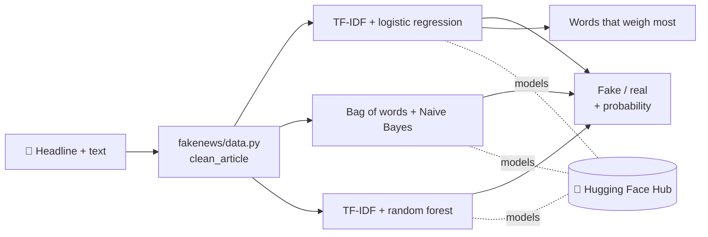
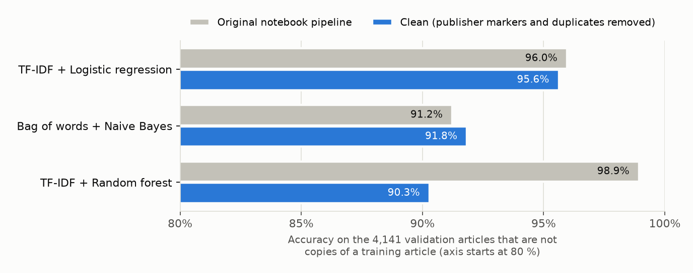
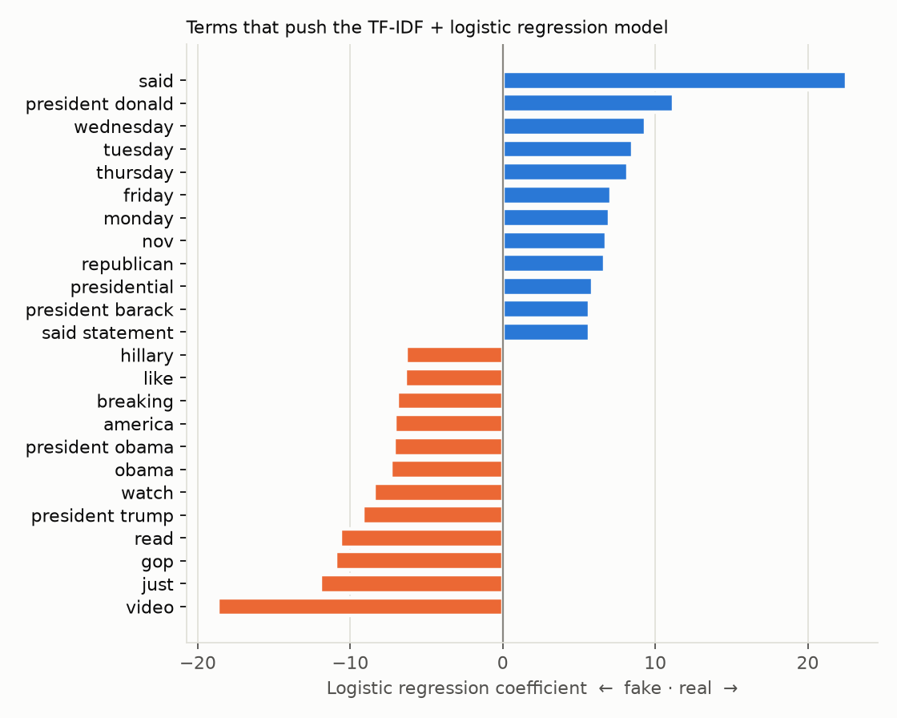

<div align="center">

# 📰 Fake News Classifier

**Three scikit-learn NLP pipelines that label English news articles as fake or real, scored on 4,141 articles they never saw during training.**


[What it does](#-what-it-does) · [Quick start](#-quick-start-in-3-steps) · [Requirements](#-system-requirements) · [Models](#-models) · [Training](#-training) · [Troubleshooting](#-troubleshooting)

</div>

---

## ✨ What it does

Paste the headline and text of a news article (or pick one of the examples) and three models say whether it is **fake or real**: **TF-IDF + logistic regression**, **bag of words + Naive Bayes** and **TF-IDF + random forest**.

| Tab | What you get |
|---|---|
| 🧾 **Verdict** | Each model's probability of fake and real, and the words of the article that push the logistic regression most towards one side or the other. |
| 📏 **How reliable are they?** | Each model's accuracy on the validation set, with and without the data leaks of the original setup, and what they actually learn. |



> ⚠️ **What they learn and what they don't.** In the ISOT dataset the label depends on the **source**: real articles are Reuters wires and fake ones come from sites flagged by PolitiFact and Wikipedia (2015-2018). The models learn to tell **agency style** (*said*, *spokesman*, the day of the week) from the style of those sites (*video*, *watch*, *just*). **They do not check facts.** The app includes a made-up example to show it: a nonsense story written like a wire comes out as real with a 99-100% probability.

- The models **download themselves** from Hugging Face the first time and are kept in a Docker volume.
- Everything runs locally on CPU, with no keys and no `.env`.

---

## 🏁 Quick start in 3 steps

> All you need is **[Docker Desktop](https://www.docker.com/products/docker-desktop/)** running and **[Git](https://git-scm.com/downloads)**. No Python install and no manual data download.

### 1️⃣ Clone the repository

```bash
git clone https://github.com/JTiiz/natural-processing-models.git
cd natural-processing-models
```

### 2️⃣ Build and start

```bash
docker compose up --build -d
```

⏱️ The first build takes a couple of minutes. Later starts take seconds.

### 3️⃣ Open the app

👉 **http://localhost:8503**

> ℹ️ The **first** load takes a few seconds longer because it downloads the three models (≈ 26 MB). After that they are cached and every classification is instant.

---

## 💻 System requirements

| Resource | Minimum | Recommended | Why |
|---|---|---|---|
| 🧠 **RAM** | 2 GB | 4 GB | With the three models loaded, the container uses about 420 MB. |
| 💾 **Free disk** | 2 GB | 3 GB | Docker image ≈ 1 GB + models ≈ 26 MB + build cache. |
| ⚙️ **CPU** | 1 core | 2 cores | Classifying an article with the three models takes a fraction of a second. |
| 🎮 **GPU** | Not needed | — | scikit-learn does not use a GPU, not even for training (1 minute on a laptop). |
| 🌐 **Internet** | Required | — | For the first build and the first model download. |

| Software | Notes |
|---|---|
| 🐳 Docker Desktop 4.x+ | On Windows, with the **WSL 2** backend. Includes `docker compose`. |
| 🔧 Git | To clone the repository. |

---

## 🧰 Useful commands

| Action | Command |
|---|---|
| ▶️ Start (without rebuilding) | `docker compose up -d` |
| 📜 Follow the logs | `docker logs -f fake-news-classifier` |
| ⏹️ Stop | `docker compose down` |
| 🔁 Rebuild after changing code | `docker compose up --build -d` |
| 🗑️ Also delete the downloaded models | `docker compose down -v` |

---

## 🤖 Models

All three are trained on the same 27,748 articles and scored on the **same 4,141 articles** of `validation_data.csv` that are not a copy of any training article. They are declared in [`models/models.yaml`](models/models.yaml).

| Model | Hugging Face | Validation accuracy | ROC AUC | Unseen section (US_News) | Internal test |
|---|---|---|---|---|---|
| **TF-IDF + logistic regression** | [jramduran/fake-news-tfidf-logreg](https://huggingface.co/jramduran/fake-news-tfidf-logreg) | **95.6%** | **0.998** | **90.8%** | 98.8% |
| **Bag of words + Naive Bayes** | [jramduran/fake-news-bow-naive-bayes](https://huggingface.co/jramduran/fake-news-bow-naive-bayes) | 91.8% | 0.957 | 78.2% | 95.9% |
| **TF-IDF + random forest** | [jramduran/fake-news-tfidf-random-forest](https://huggingface.co/jramduran/fake-news-tfidf-random-forest) | 90.3% | 0.993 | 80.7% | 97.4% |

<p align="center">
  
  
  
</p>

All three fail mostly in one direction: **they let fake articles through as real** (between 176 and 386 of 2,757) and almost never flag a real one as fake (between 5 and 22 of 1,384). The section they never saw in training weighs more than its share: US_News is 28% of the validation fakes but accounts for 41% of the ones the logistic regression misses (72 of 176).

**How each model is resolved:**
1. If `models/<folder>/` exists (for example, a model you have just trained), that local copy is used.
2. Otherwise it is downloaded from its Hugging Face `hub_id`.

---

## 🧪 Training

The code is in [`training/`](training/) and is reproducible end to end.

| | |
|---|---|
| **Data** | [ISOT Fake News Dataset](https://onlineacademiccommunity.uvic.ca/isot/2022/11/27/fake-news-detection-datasets/) (University of Victoria), in the version of the Ironhack project: `data.csv` for training and [`data/validation_data.csv`](data/validation_data.csv) as external validation. `data.csv` is not redistributed: the same articles are read from a [copy on Hugging Face](https://huggingface.co/datasets/haoxianc/gilchr_fake-and-real-news-dataset) (MIT) at a fixed revision. It matches `data.csv` 100%, although its label is inverted, which is fixed on load. |
| **Validation labels** | `validation_data.csv` came unlabelled (`label = 2`). Since in ISOT the label depends on the section, they are recovered from the `subject` column: `worldnews` is real and the rest are fake. |
| **Cleaning** | Lower case and letters only, as in the notebooks. In addition, the markers that give away the source are removed: the Reuters dateline, image credits, links and @handles. |
| **Split** | Duplicates are removed **before** holding out 20% as an internal test set. Validation is external and contains no copies of training articles. |
| **Hardware** | CPU · **1 minute** for all six trainings (3 models × 2 setups) |

**Three data leaks in the original setup.** The notebooks reached 99.9% accuracy. Reviewing them revealed three problems:

1. **A single word separated the classes.** 99.2% of the real articles start with *"WASHINGTON (Reuters) -"* and no fake one does. On top of that, almost half of the training fakes (those in the *News* section) end with *"Featured image via…"*.
2. **There were 3,418 duplicate articles** in the training data, which a random split put in both train and test.
3. **815 of the 4,956 validation articles were copies** of training articles, published again under another section. For example, all of the *Middle-east* ones.

The models are trained both ways and compared on the same 4,141 validation articles:

<p align="center">
  
</p>

| Model | Original (notebooks) | Clean (used by the app) |
|---|---|---|
| TF-IDF + logistic regression | 96.0% | 95.6% |
| Bag of words + Naive Bayes | 91.2% | 91.8% |
| TF-IDF + random forest | 98.9% | 90.3% |

**Reading the results:**
- 🔵 The **logistic regression** is the most reliable: it barely changes when the leaks are removed, and it copes best with the section it never saw in training (US_News).
- 🟠 The **random forest** looked like the best model, but its lead came almost entirely from the word *reuters*. Without it, it drops from 98.9% to 90.3%.
- 🟡 **Naive Bayes** improves a little with the cleaning and the bigrams, but it is still the weakest on new sections (78%).
- ⚪ What is left is **style**. These are the words that weigh most in the logistic regression:

<p align="center">
  
</p>

**Reproduce it** (requires [uv](https://github.com/astral-sh/uv)):

```bash
uv sync --group train
uv run --group train python training/train.py      # downloads the dataset (116 MB) and trains
uv run --group train python training/report.py     # charts and comparison table
uv run python training/examples.py                 # the app's examples (data/examples.json)
```

`train.py` saves the models in `models/fake-news-<model>/`, so the app uses them automatically instead of the ones on Hugging Face. Metrics and validation probabilities are saved in `training/reports/`.

> 📓 The notebooks in [`notebooks/`](notebooks/) are the original work: exploratory analysis, one notebook per model and the final comparison. A few things worth knowing when reading them:
> - The EDA labels the classes the wrong way round: 0 is fake and 1 is real.
> - The Naive Bayes word charts show the most frequent words of each class, not the most discriminative ones.
> - The validation step only counted how many articles came out fake, because it had no labels.

---

## ⚙️ Configuration

| Variable | Default | Description |
|---|---|---|
| `MODELS_ROOT` | `/app/models` | Folder searched for local models before going to Hugging Face. |

---

## 🩺 Troubleshooting

<details>
<summary><b>❌ <code>Cannot connect to the Docker daemon</code></b></summary>

Docker Desktop is not running. Open it, wait until it shows *Engine running* and run the command again.
</details>

<details>
<summary><b>❌ <code>port is already allocated</code> (port 8503 in use)</b></summary>

Another process is using port 8503. Change the mapping in `docker-compose.yml`, for example to `"8504:8501"`, and open `http://localhost:8504`.
</details>

<details>
<summary><b>❌ The first load stays on "Loading the three models..."</b></summary>

The app is downloading the models from Hugging Face. Check your connection and follow the progress with `docker logs -f fake-news-classifier`. If it fails halfway, reload the page and the download will resume.
</details>

<details>
<summary><b>❌ An article in another language always comes out fake or real</b></summary>

The models only know English vocabulary from 2015-2018. In another language almost no word matches, so the result means nothing.
</details>

---

## 🛠️ Local development (without Docker)

Requires Python 3.12 and [uv](https://github.com/astral-sh/uv).

```bash
uv sync
uv run streamlit run app.py      # http://localhost:8501
```

---

## 📂 Project structure

```text
.
├── app.py                    # Streamlit app: the three models' verdict and their reliability
├── fakenews/
│   └── data.py               # Dataset loading and text cleaning (training and app)
├── data/
│   ├── validation_data.csv   # The project's external validation set (4,956 articles)
│   └── examples.json         # Example articles for the app
├── models/
│   └── models.yaml           # Model registry (local or Hugging Face)
├── .streamlit/config.toml    # App theme
├── Dockerfile                # Two-stage build (uv + Python 3.12 slim)
├── docker-compose.yml
├── pyproject.toml            # Dependencies ("train" group for training)
├── training/
│   ├── train.py              # Trains and evaluates the 3 models in the 2 setups
│   ├── report.py             # Charts, confusion matrices and comparison table
│   ├── examples.py           # Builds data/examples.json
│   ├── upload_to_hub.py      # Publishes the models on Hugging Face
│   └── reports/              # Metrics, validation probabilities and charts
└── notebooks/                # EDA, one notebook per model and the original comparison
```
